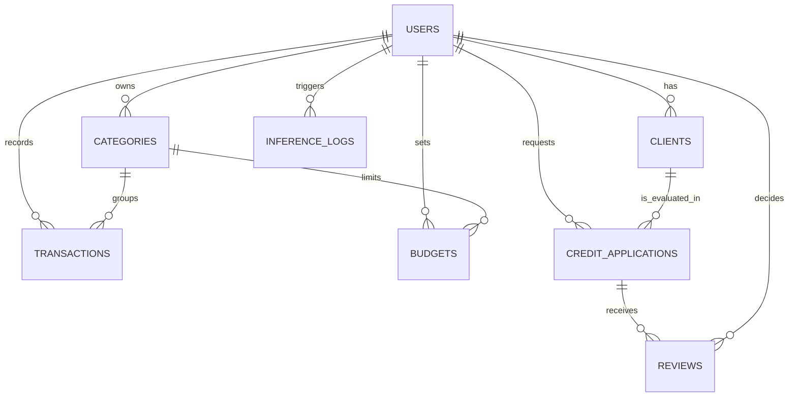

# Database

Description of `app/models.py`, in the order of the file. Sections 1 to 9 describe the tables of the first version; the section "Tables added for roles and the request flow" describes what was added later.

## Tables

### 1. Libraries

Before creating the tables, the file loads the tools it will need. One saves the exact date and time of each record. Another checks and cleans a value before it is stored, for example to reject a value that makes no sense. The last ones protect passwords: instead of saving the password as typed, they save an encoded version that cannot be read, so even if someone gained access to the database, they would not see the real passwords.

### 2. Allowed options

These are closed lists of valid values for certain fields. A transaction can only be income or expense. Employment status can only be employed, self-employed, retired or unemployed. Payment history can only be good, fair or poor. The risk result can only be Approved, Medium Risk or High Risk. This prevents mistakes such as typing “expense “ with an extra space or “Expense” with a capital letter, which would later break the calculations.

### 3. Helper functions

These are three helpers used across several tables. The first returns the current date and time, and is used to record when something was created. The second builds the rule that tells the database to accept only the values from a given list in a certain field. The third does the same from the program side: it checks what is about to be saved and shows an error if it is not on the list. This gives double protection, first in the program and then in the database.

### 4. Users table

This is the main table. It stores the username and the email, and neither can be repeated. It also stores the encoded password, the role (applicant, analyst or admin; every new account is an applicant) and the date the person registered. This table connects to all the others: one user can have many categories, transactions, budgets, clients and credit applications, and each of those records belongs to a single user. It also has two functions: one to store the password securely at registration and another to check whether the password typed at login is correct.

### 5. Categories table

It is used to classify money, for example “Food” as an expense or “Salary” as income. Each category has a name, a type and the user it belongs to. A rule prevents the same user from repeating the same name with the same type, although “Transport” as an expense can exist for two different users. A category connects to its transactions and to its budgets.

### 6. Transactions table

Every income or expense the user records is stored here. It saves the type, the amount (with two decimals), the date, an optional description, the category it belongs to and the user who owns it. This is the table that will grow the most, since every purchase or payment is a new row.

### 7. Budgets table

It represents a spending limit: the maximum amount of money the user wants to spend on a category during a month. That is why it stores the amount, the month (always as the first day of that month), the category and the user. By comparing this limit with the month’s transactions, the page can warn the person if they are going over.

### 8. Clients table

This table holds the customer of each request. For an applicant it is created automatically with the first request and reused afterwards. It stores the full name, the document number and the registration date. The same user cannot save two clients with the same document number, but two different users could each have a client with that number. One client can have several credit applications.

### 9. Credit applications table

This is the credit risk part of the page. Each row is one evaluation and includes two groups of data:

- **Input data:** age, monthly income, employment status, years of employment, credit score (between 300 and 850), existing debt, debt-to-income percentage, loan amount and term in months, previous loans and payment history.
- **Model result:** the risk level (Approved, Medium Risk or High Risk), the risk percentage (from 0 to 100) and the version of the model that made the calculation, which is useful for knowing which model produced each result if it is retrained later.

The second image completes the table: it links it to the client being evaluated and to the user who ran the evaluation, stores the date, and checks that employment status, payment history and risk level are values from the allowed lists.

## Tables added for roles and the request flow

- **Role of the user.** The users table has a `role` column with three allowed values: applicant, analyst and admin. The registration always stores applicant. Only an administrator changes a role.
- **Status and outcome of a credit application.** Each row of the credit applications table has a `status` (Pending, Documents requested, Approved, Rejected or Withdrawn) and an `outcome` (Repaid or Defaulted) with its date. The outcome stays empty until the real result of an approved loan is known. Totals and rates are never stored: they are calculated when a page is read.
- **Reviews table.** One row per decision of an analyst on a request: the request, the analyst, the decision (Approved, Rejected or Documents requested), the written justification, whether the decision followed the model (empty when the model gave no clear recommendation), whether the review was mandatory and the date. A request can have several reviews because an analyst can ask for documents first.
- **Inference logs table.** One row per call to a model: date, user, model, model version, result, risk percentage, response time in milliseconds and the error text when it failed. It holds no password and no document number.

## Relationships

- One user has many categories, transactions, budgets, clients and credit applications (one-to-many); each of those rows belongs to one user.
- One category has many transactions and many budgets.
- One client has many credit applications.
- One credit application has many reviews; each review belongs to one analyst (a user).
- One user can have many inference log rows; the user of a row stays empty if the call was made without a session.

## How to install the database

1. Create and activate the virtual environment of the repository, then run `pip install -r requirements.txt`.
2. Set `SECRET_KEY` in the environment. Without `DATABASE_URL` the application uses the local SQLite file `instance/credit_risk.db`; with `DATABASE_URL` it uses PostgreSQL.
3. Create the tables with `flask --app run db upgrade`. The tables are created only by migrations, never when the application starts.
4. Create the first administrator with `flask --app run create-user --role admin`; the password is read from an environment variable and is never stored in the repository.

## How to run the migrations

- Apply all migrations: `flask --app run db upgrade`.
- Revert the last one: `flask --app run db downgrade`.
- Create a new one after changing `app/models.py`: `flask --app run db migrate -m "message"`, then review the file in `migrations/versions/`.
- Before a migration on a database with data, copy `instance/credit_risk.db` to `instance/backups/` with the date in the name. The migrations of this project are `0001` (initial schema), `0002` (unique category per user and type), `0003` (user roles) and `0004` (request flow, reviews and inference log); each one has a downgrade.
