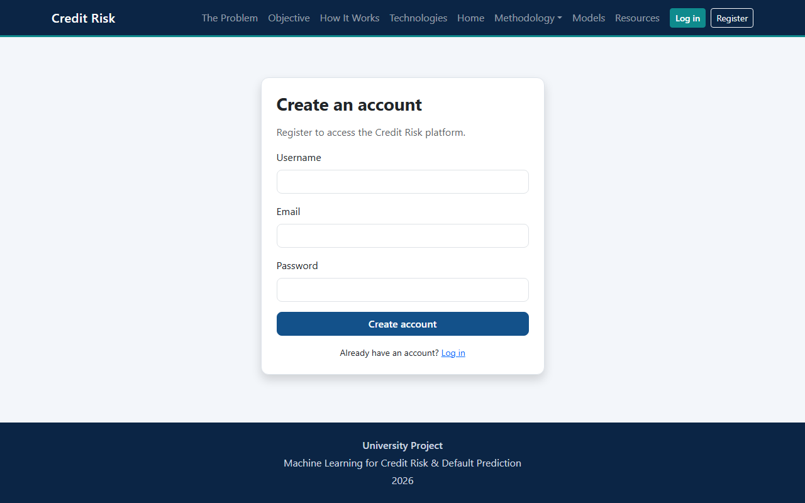
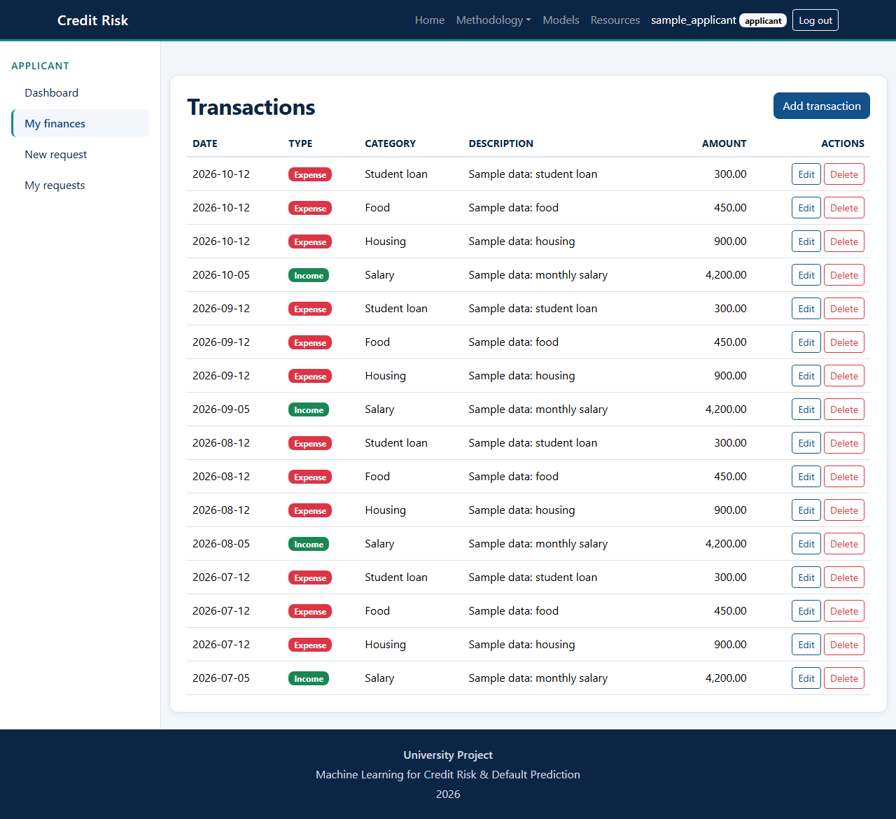
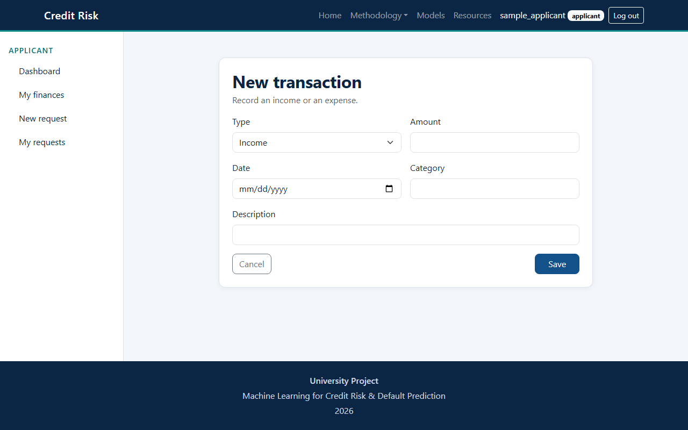
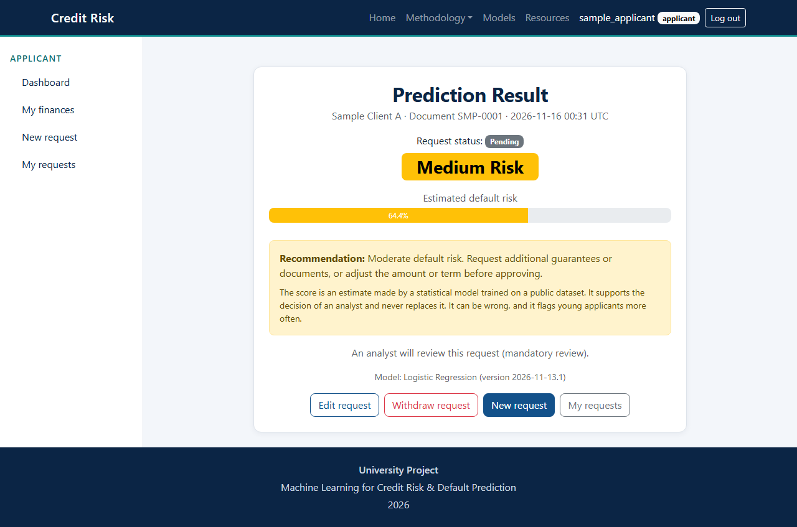
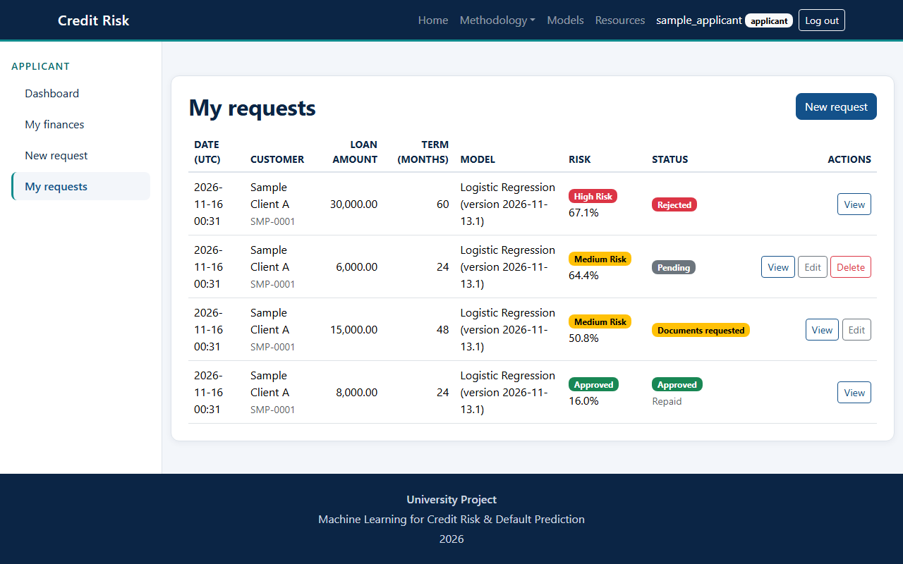

# User Manual

Credit Risk and Loan Viability Prediction Platform

Credit Risk is a web platform with two purposes: to record your income and expenses and follow your balance, and to request a loan that a credit analyst reviews with the help of a machine learning model. This manual explains each screen step by step. The figures use invented sample data.

The application is available at https://credit-risk-dxit.onrender.com/. It works in any modern browser, on a computer or a phone. Each account only sees its own data: nobody else can see your transactions or requests. Analysts and administrators have their own pages and are not described in this manual.

## Getting started

**1. Create an account.** On the home page, click Register. Fill in the username, the email and a password of at least 8 characters, then click Create account. You are sent back to the home page with a message saying the account was created. Every new account is an Applicant: the registration does not let you choose another role, and only an administrator can change it later. If the username or email is already registered, or the password is too short, a red message explains it.

*Figure 1. Registration form*

**2. Log in.** On the home page, use the Log in card: type the email and password, optionally tick Remember me, and click Log in. You can also use the Log in button in the top bar. You land on your Dashboard. A wrong email or password shows an error message and you can try again.

*Figure 2. Log in card on the home page*

**3. Menus.** Before you log in, the top bar shows only the public pages: Home (with the project documentation), Methodology, Models (results of the trained models, read only) and Resources, plus Log in and Register. After you log in, the top bar keeps those public pages and shows your username and the Log out button, and a menu on the left shows your own pages: Dashboard, My finances, New request and My requests. The current page is highlighted. If you open a private page while logged out, you are sent to the login card and, after logging in, taken to the page you asked for. If you open a page that belongs to another role, the system shows an Access denied page.

*Figure 3. Top bar and menu on the left while logged in*

## Finances

**4. Dashboard.** Shows four cards calculated from your own transactions each time you open the page: Income (the sum of your incomes), Expenses (the sum of your expenses), Balance (income minus expenses) and Credit evaluations (how many requests you have made, with a link to create a new one). Below them, the card Check my credit risk opens the credit request with your monthly income and your debt-to-income ratio already filled in from your recorded transactions (the last complete months). You complete the remaining fields and send the request.

*Figure 4. Dashboard*

**5. Transactions list.** Lists your incomes and expenses, newest date first. Each row shows the date, the type (Income in green, Expense in red), the category, the description and the amount, and has an Edit and a Delete button. Use the Add transaction button to record a new one. When the list is long, use the page links at the bottom to move between pages.

*Figure 5. Transactions list*

**6. Add a transaction.** Click Add transaction to open the New transaction form. Choose the type (Income or Expense), type an amount (a positive number with at most two decimals), a date, a category (required, up to 50 characters; it is created the first time you use it) and an optional description. Click Save to record it, or Cancel to go back without saving.

*Figure 6. New transaction form*

**7. Edit and delete a transaction.** Edit opens the same form with the current values already filled in; the same rules apply. Delete opens a confirmation page that warns “This cannot be undone” and shows the date, type, category, description and amount of the transaction. Nothing is deleted until you click the red Delete button; Cancel takes you back to the list without changing anything.

*Figure 7. Delete confirmation*

## Credit evaluation

**8. Credit request form.** Open New request from the menu on the left, or click Check my credit risk on the Dashboard. All amounts are in US dollars (USD), and the income must be the monthly one, not the annual one. Your full name and document number are filled in after your first request, so you do not have to type them again. Then enter the loan data: age (18 to 100), monthly income, employment status, years of employment, credit score (300 to 850), existing debt, debt-to-income ratio (%), loan amount, loan term in months (1 to 480), previous loans and payment history. When you start from Check my credit risk, the monthly income and the debt-to-income ratio come already filled in from your recorded transactions, and you complete the rest. If a value is invalid, the form returns with a message and keeps what you typed. Click Send request to send the form.

*Figure 8. Credit request form*

**9. Result and status of the request.** After you send the request, the system scores it with the model and the result page shows the customer, the document number and the date of the request (in UTC), the status of the request, a label, the estimated default risk as a bar and a recommendation. Approved (green) means low risk, Medium Risk (yellow) moderate risk and High Risk (red) high risk. The score is an estimate made by a statistical model: it helps the analyst, it never decides alone, and it can be wrong. A new request is always Pending until a credit analyst reviews it. The status can be: Pending (waiting for the analyst), Documents requested (the analyst needs more information), Approved, Rejected or Withdrawn (you cancelled it). When the analyst decides, the page shows the decision and the reason that the analyst wrote. In Pending or Documents requested you can click Edit request (or Update with the documents) to change the data: the request is scored again and goes back to Pending. You can also click Withdraw request to cancel it. Approved, Rejected and Withdrawn are final.

*Figure 9. Result and status of the request*

**10. My requests.** Lists your requests, newest first. Each row shows the date (UTC), the customer, the loan amount, the term in months, the model and version that scored it, the risk and the status. View reopens the result page, Edit opens the form for a request that is still open, and Delete (only for Pending or Withdrawn requests) asks for confirmation first. A request that an analyst already decided cannot be edited or deleted, so the history of decisions is kept. The New request button at the top takes you back to the form.

*Figure 10. My requests*

## Help

**11. Common messages.** Invalid email or password: the email or the password you typed at login is wrong; check both and try again. Page not found (404): the page does not exist or was moved, or the record you asked for does not exist, was already deleted, or belongs to another account. Click Back to home to return to the start. A security or form error: the form expired, so reload the page and submit it again.

*Figure 11. Page not found (404)*
