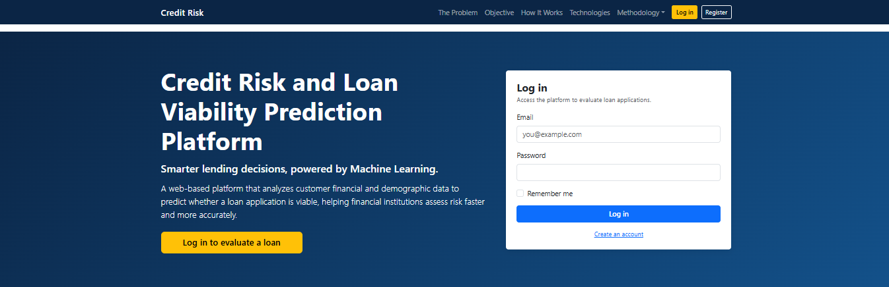
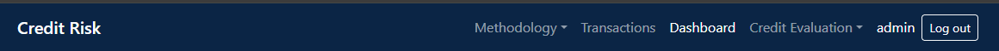
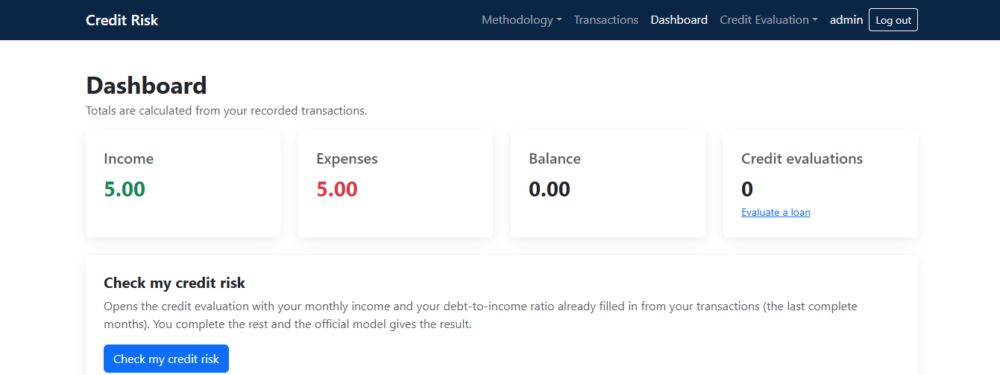
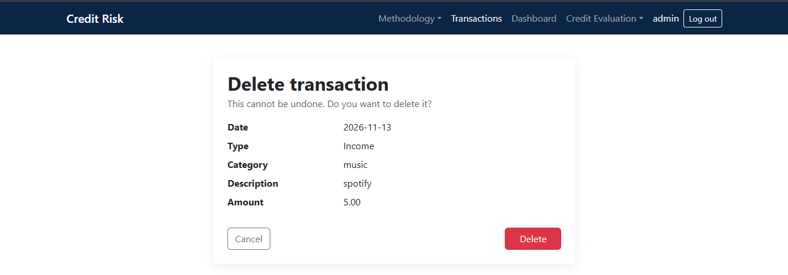
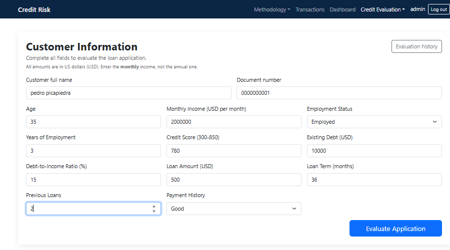
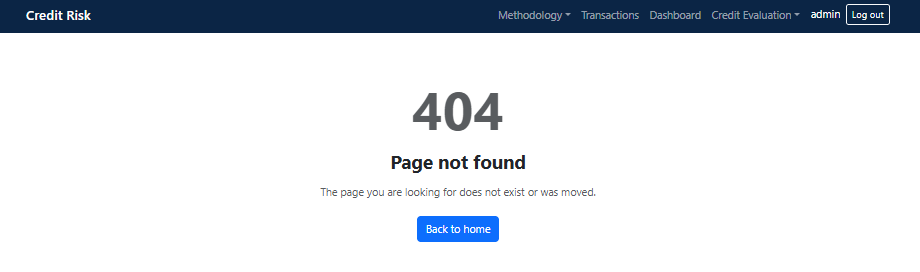

# User Manual

Credit Risk and Loan Viability Prediction Platform

Credit Risk is a web platform with two purposes: to record your income and expenses and follow your balance, and to evaluate whether a loan is viable using a machine learning model. This manual explains each screen step by step.

The application is available at https://credit-risk-dxit.onrender.com/. It works in any modern browser, on a computer or a phone. Each account only sees its own data: nobody else can see your transactions or evaluations.

## Getting started

**1. Create an account.** On the home page, click Register. Fill in the username, the email and a password of at least 8 characters, then click Create account. You are sent back to the home page with a message saying the account was created. If the username or email is already registered, or the password is too short, a red message explains it.

*Figure 1. Registration form*

**2. Log in.** On the home page, use the Log in card: type the email and password, optionally tick Remember me, and click Log in. You can also use the Log in button in the top bar or the Log in to evaluate a loan button. You land on the Dashboard. A wrong email or password shows an error message and you can try again.

*Figure 2. Log in card on the home page*

**3. Navigation bar.** Once logged in, the top bar shows the menu Methodology, the links Transactions and Dashboard, the menu Credit Evaluation, your username and the Log out button. The current page is highlighted in white. If you open a protected page while logged out, you are sent to the login card and, after logging in, taken to the page you asked for.

*Figure 3. Top bar while logged in*

## Finances

**4. Dashboard.** Shows four cards calculated from your own transactions each time you open the page: Income (the sum of your incomes), Expenses (the sum of your expenses), Balance (income minus expenses) and Credit evaluations (how many loans you have evaluated, with a link to evaluate a new one). Below them, the card Check my credit risk opens the credit evaluation with your monthly income and your debt-to-income ratio already filled in from your recorded transactions (the last complete months). You complete the remaining fields and the model gives the result.

*Figure 4. Dashboard*

**5. Transactions list.** Lists your incomes and expenses, newest date first. Each row shows the date, the type (Income in green, Expense in red), the category, the description and the amount, and has an Edit and a Delete button. Use the Add transaction button to record a new one. When the list is long, use the page links at the bottom to move between pages.

*Figure 5. Transactions list*

**6. Add a transaction.** Click Add transaction to open the New transaction form. Choose the type (Income or Expense), type an amount (a positive number with at most two decimals), a date, a category (required, up to 50 characters; it is created the first time you use it) and an optional description. Click Save to record it, or Cancel to go back without saving.

*Figure 6. New transaction form*

**7. Edit and delete a transaction.** Edit opens the same form with the current values already filled in; the same rules apply. Delete opens a confirmation page that warns “This cannot be undone” and shows the date, type, category, description and amount of the transaction. Nothing is deleted until you click the red Delete button; Cancel takes you back to the list without changing anything.

*Figure 7. Delete confirmation*

## Credit evaluation

**8. Credit evaluation form.** Open Credit Evaluation from the top bar, or click Check my credit risk on the Dashboard. The page is called Customer Information, and the button Evaluation history at the top right opens your past evaluations. All amounts are in US dollars (USD), and the income must be the monthly one, not the annual one. Enter the customer’s full name and document number, then the loan data: age (18 to 100), monthly income, employment status, years of employment, credit score (300 to 850), existing debt, debt-to-income ratio (%), loan amount, loan term in months (1 to 480), previous loans and payment history. When you start from Check my credit risk, the monthly income and the debt-to-income ratio come already filled in from your recorded transactions, and you complete the rest. If a value is invalid, the form returns with a message and keeps what you typed. Click Evaluate Application to send the form.

*Figure 8. Customer Information form*

**9. Prediction result.** After you click Evaluate Application, the Prediction Result page shows the customer, the document number and the date of the evaluation (in UTC), a label, the estimated default risk as a bar and a recommendation. Approved (green) means low risk, Medium Risk (yellow) moderate risk and High Risk (red) high risk. When the risk is very low the bar looks empty; the exact percentage appears in the Evaluation history. A line at the bottom names the model that produced the result and its version. The result is saved automatically, and the buttons Evaluate Another Application and Evaluation history let you continue.

*Figure 9. Prediction result*

**10. Evaluation history.** Lists your past evaluations, newest first. Each row shows the date (UTC), the customer, the document number, the loan amount, the term in months, the model and version that produced the result, the result and the risk percentage. View reopens the full result and Delete asks for confirmation first. Evaluations cannot be edited: to correct one, delete it and create a new one. The New evaluation button at the top takes you back to the form.

*Figure 10. Evaluation history*

## Problems

**11. Common messages.** Invalid email or password: the email or the password you typed at login is wrong; check both and try again. Page not found (404): the page does not exist or was moved, or the record you asked for does not exist, was already deleted, or belongs to another account. Click Back to home to return to the start. A security or form error: the form expired, so reload the page and submit it again.

*Figure 11. Page not found (404)*
